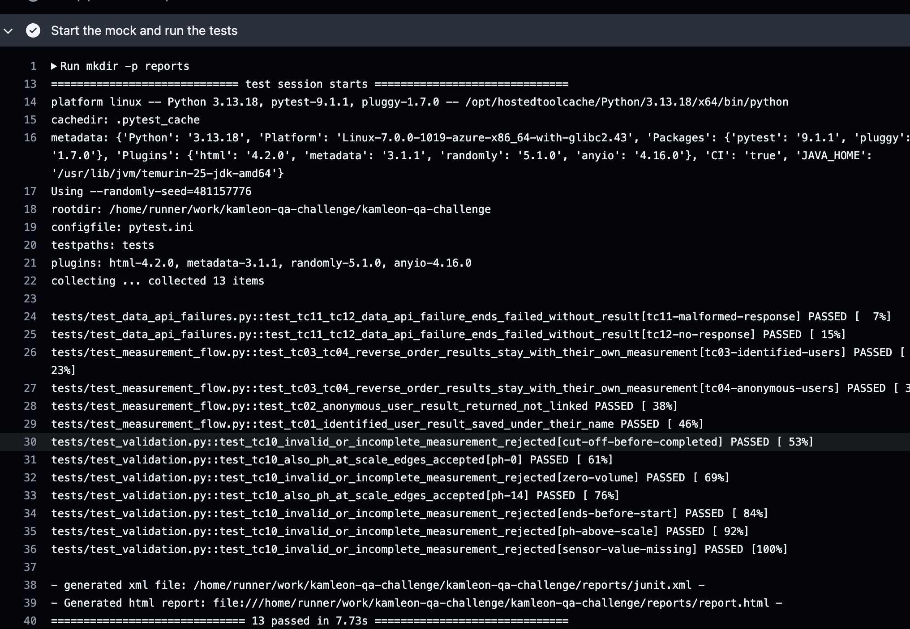
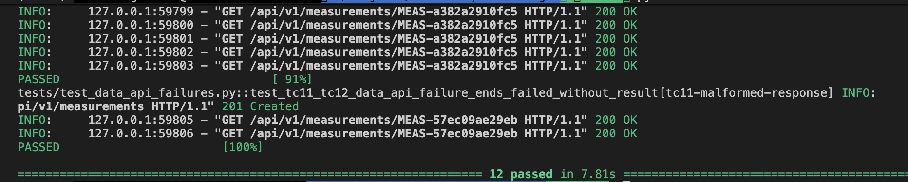

# Kamleon QA Engineer — technical challenge

A mock of the backend API contract (the measurement endpoints) and an automated API test suite that runs against it.
The test strategy (Part 1) and the test design (Part 2) are in [`docs/`](docs/).

## Quick start

Tested with **Python 3.13**.

```bash
python3.13 -m venv .venv
source .venv/bin/activate
pip install -r requirements.txt
```

Run everything (two commands). The mock runs in the background (`&`) and the tests only call it
over HTTP. They don't start it themselves, so the same tests can run against another
environment (see below).

```bash
uvicorn mock.app:app --port 8000 &
pytest
```

Stop the mock with `kill %1`.

The test order is shuffled on every run (pytest-randomly). The seed is printed at the top of the run:

| To | Run |
|---|---|
| Repeat a run's order | `pytest --randomly-seed=<seed>` |
| Run in file order | `pytest -p no:randomly` |
| Run one file | `pytest tests/test_validation.py` |

## Running against another environment

The tests reach the API only over HTTP, at `BASE_URL` (default `http://localhost:8000`).
To run them against a real environment, skip the mock and point `BASE_URL` there:

```bash
BASE_URL=https://staging.example.com pytest -m "not mock_only"
```

A real-environment run also relies on the assumptions in
[Contract gaps and assumptions](#contract-gaps-and-assumptions) (e.g. status codes, the resend rule).

Tests marked `mock_only` (TC-03/TC-04, TC-11/TC-12) control the mock's fake Data API through a
test-only header (`X-Mock-Data-API`), to make it slow, malformed or unresponsive. A real backend
ignores the header, so these tests need a stub in the Data API's place to run there
(see [What I'd do with more time](#what-id-do-with-more-time)).

## Project layout

```
mock/app.py                       fake implementation of the measurement endpoints, served over HTTP
tests/conftest.py                 BASE_URL, wait for the API to be up, test-data factory
tests/helpers.py                  create a measurement; poll until it leaves "processing"
tests/test_measurement_flow.py    TC-01, TC-02, TC-03/TC-04
tests/test_validation.py          TC-10
tests/test_data_api_failures.py   TC-11/TC-12 (mock only)
pytest.ini                        test path, strict markers, the mock_only marker
.github/workflows/tests.yml       CI: runs the suite in random order and keeps the reports
docs/strategy.pdf                 Part 1: test strategy and roadmap
docs/test-design.md               Part 2: test design (14 cases)
```

## Test coverage

Priority comes from risk, as set in the [test design](docs/test-design.md), where every case has
its full fields. The suite automates the cases the given contract lets me test honestly against
the mock. The other cases keep their priority: they wait for what they need, not for a lower rank.

**Automated** (each test name starts with its case ID)

| Case | Priority | File |
|---|---|---|
| TC-01 Identified user → result under their name | P1 | `test_measurement_flow.py` |
| TC-02 Anonymous user → result, not linked | P1 | `test_measurement_flow.py` |
| TC-03 Two identified users, results in reverse order → right user | P1, top 3 | `test_measurement_flow.py` (mock only) |
| TC-04 Two anonymous users, results in reverse order → right measurement | P1 | same test as TC-03 (mock only) |
| TC-10 Invalid or incomplete measurement → rejected | P1 | `test_validation.py` |
| TC-11 Data API malformed response → `failed` | P1 | `test_data_api_failures.py` (mock only) |
| TC-12 Data API doesn't respond → `failed`, not stuck | P2 | same test as TC-11 (mock only) |

**Why TC-04 and TC-12 are in** (each cost one parametrize row in an existing test):

TC-04: a result swapped between anonymous measurements goes unnoticed, because there's no user ID to match on.

TC-12: the only check of the asynchronous timeout path.

**Not automated here** (top 3 first, then by priority)

| Case | Priority | Risk | Needs | Runs once unblocked |
|---|---|---|---|---|
| TC-06 Access outside permissions → denied | P1, top 3 | One user reads another person's health data; can't be undone | Login with user roles (not in the contract) | After every deployment to staging |
| TC-08 Implausible readings → no result | P1, top 3 | A confident but wrong result the user acts on | The real Data API and the data team's thresholds | Every Data API PR |
| TC-05 Measurement for a user not identified in that session → rejected | P1 | Saved under someone who wasn't at the device | A way to create a session (not in the contract) | Every PR |
| TC-07 No health data in the logs | P1 | A silent privacy leak | Service logs on staging | Nightly |
| TC-09 Data API update → same results | P1 | Results change silently for every user | The data team's reference readings | Every Data API PR |
| TC-14 Identified user on a real device → display shows their result | P1 | Parts work alone but not together | A real device and display | Manual, before every release |
| TC-13 Buffered measurements → each saved once | P2 | A duplicate; visible and can be removed | Nothing; buildable with this mock | Next to automate |

**Device endpoints** (status, mode, firmware update) are not in this suite: the test design covers
the measurement flow, where the top risks are (wrong user, data leak, wrong result). First device
test to add: get device → change mode → verify the new state → restore the mode (the mock gets
the device endpoints with it).

## Main technical decisions

| Decision | Instead of | Why |
|---|---|---|
| **A fake implementation of the contract, served as a mock server** (FastAPI) | Stubs inside the tests (responses, respx) | It implements the real rules, so a test can fail; tests reach it only over HTTP, so they also run against a real environment. |
| **Libraries:** requests (HTTP calls) · uvicorn (serves the FastAPI mock) · pytest-html (report for people) | httpx · Flask's built-in server · JUnit XML only | requests is the simplest and best-known client. uvicorn is FastAPI's standard server. HTML is what a person opens; JUnit XML (built into pytest) is what CI reads. |
| **Assertions on what happened to the measurement** | Checking the HTTP code | A failed measurement still returns 200, so tests check its status, user and result. TC-03/TC-04 first check that the race really happened, then compare each hydration with the same readings sent alone; TC-10 checks that a rejected measurement wasn't stored, then confirms the resend rule that check relies on. |
| **Polling with a timeout** (every 0.5s, up to 10s) | A fixed sleep | A sleep guesses the timing; a stuck measurement fails with a clear message. |
| **Unique test data per measurement** (`QA-TEST-` IDs from a factory fixture) | Fixed test data | No delete endpoint, so data can't be cleaned up; unique IDs keep tests independent. |
| **Data API faults injected per request** (test-only header) | One switch that breaks the Data API for everyone | A fault can't leak into another test. |
| **One test, one row per input** (`parametrize`) | A test per input, or a loop | A new input is one new row; each row has its own verdict and case ID. |
| **Random test order on every run** (pytest-randomly) | A fixed order | Proves the tests are independent; the printed seed repeats an order. |

## Contract gaps and assumptions

The contract leaves these points open. For each one: the assumption I made, where it's used, and what I'd ask the team.

| Gap | Assumption made | Where used | Question or proposal for the team |
|---|---|---|---|
| The contract shows no HTTP status codes and no error format | New measurement → 201 · invalid input → 400 or 422 (tests accept both) · unknown measurement → 404 | 201: the `create_measurement` helper · 400/422: TC-10 · 404: the mock | Which code for each case (created, resent, invalid, not found), and what does an error look like? Once agreed, TC-10 checks one code. |
| The example response shows only a completed measurement: nothing says what `result` is while `processing` or after `failed`, or how an anonymous `userId` comes back | `result` is `null` until `completed` and stays `null` on `failed` · an anonymous `userId` is `null` | The mock, TC-02, TC-11, TC-12 | Is that the response shape, or are the fields left out? |
| No idempotency key: the contract doesn't say how the backend recognizes a resent measurement, or what it returns | Same device + session + start time = the same measurement → 200 with the original ID (a new one → 201). A 409 "duplicate" error would also be reasonable. | The mock, TC-10 (proves "not stored" through it, then confirms the rule), TC-13 (designed, not automated) | What counts as the same measurement, and should a resend return the original ID or 409? Proposal: the device sends its own ID with every measurement (idempotency key). |
| No way to create a session, identify a user or register a device; no rule linking `userId` to `sessionId` | Any session and device ID is accepted · anonymous measurements still have a session ID · identified-user tests start after identification (against a real backend, test setup identifies the user first) | The mock, TC-01, TC-02, TC-03; blocks TC-05 | Does the backend reject a measurement whose user wasn't identified in that session? Proposal: a way to create a session in test environments (API or seed script), so TC-05 can be automated. |
| No login, roles or client separation; example IDs look sequential | The mock has no login. Customer organizations (e.g. clubs) are walled off from each other; athletes see only their own data; staff see only their own organization's athletes. The mock uses random IDs. | The mock; blocks TC-06 (top 3) | Who may read which measurements, and are IDs sequential? Proposal: one way to create test users with roles (API or seed script), so a fixture creates them and TC-06 runs on staging. |
| No way to list a user's or a device's measurements | A rejected measurement is proved "not stored" through the resend rule: the valid copy must come back as new (201) | TC-10; TC-13 (designed, not automated) | Proposal: a list endpoint (per user or device), at least in test environments, so tests can check that exactly one record exists. |
| No way to delete a measurement | Tests can't clean up, so each one creates unique data with a `QA-TEST-` prefix | Every test (the `make_measurement` factory fixture) | Proposal: a delete endpoint in test environments, or a job that removes `QA-TEST-` data. Cleanup then goes into the fixture, and no test changes. |
| No time limit for the Data API, no retry rule, no reason on `failed`, and no rule for a result that arrives after `failed` | The backend waits 2s (configurable) and doesn't retry · `failed` is final · a late result is ignored | The mock, TC-12 (time limit) · the mock only (`failed` is final, a late result is ignored) | What's the time limit, and is `failed` final? Proposal: a retry queue that retries the Data API a few times before `failed`, with the measurement ID as idempotency key so a retry never creates a second result. |
| The Data API's response isn't defined, and the task doesn't say whether the same readings always give the same result | The backend accepts an answer only if hydration and volume are numbers; otherwise `failed` · the model is deterministic | The mock, TC-11; TC-09 (designed, not automated) | What fields and types does the Data API return? Is the model deterministic? If not, TC-09 compares within a tolerance the data team sets. |
| No units or valid ranges for sensor values, no minimum volume or duration, no rule on timestamp order, no hydration scale | All fields required (`userId` may be null for anonymous) · volume above 0 · pH 0–14 (the scale itself, not a clinical limit) · no temperature range · end time after start time · hydration is a placeholder that differs per volume | The mock, TC-10 (ranges, required fields, end after start) · TC-02, TC-04 (`userId` null) · TC-03/TC-04 (hydration differs) | What are the units and valid ranges of each value, and the minimum volume and duration? What scale is hydration on? These belong to the data and hardware teams; TC-10 then gets one row per limit. |
| No field on the result to mark it as unreliable (e.g. readings from a degraded sensor) | Implausible readings end `failed`, with no result shown | TC-08 (top 3, designed, not automated) | How should an untrusted result reach the user: `failed`, a quality field, or "please measure again"? The thresholds belong to the data team; with them as test data, TC-08 can be automated. |
| No endpoint for the display; the task doesn't say how it gets the result, what it shows, or when it clears | The display shows who the result belongs to | TC-14 (manual, on a real device) | Does the display ask for a result by measurement or by session, and when does it clear? Proposal: show the profile the result was saved under next to it, so a wrong result is visible right away. |
| Device endpoints: no rule for a measurement sent by a device in `maintenance` or `offline`; a firmware update returns `update_started`, but no status shows that it finished or failed; nothing on the same command received twice | Not in this suite (the mock has no device endpoints). The strategy assumes: maintenance mode rejects measurements; a command to an offline device is queued and applied once. | Not in this suite | Does maintenance mode block measurements? How does a client see that a firmware update finished or failed? Is a repeated command applied only once? |

## Evidence of execution

Every push runs the suite in [GitHub Actions](https://github.com/HananGershon/kamleon-qa-challenge/actions).
Each run keeps a `test-report` artifact with an HTML report, JUnit XML and the mock's log.

**CI run**



**Local run**



## What I'd do with more time

First, automate TC-13 (buffered measurements saved once): it needs nothing new and runs against this mock.

Then tools and process to grow the suite, in order of value:

| What | Why | When |
|---|---|---|
| **WireMock in the Data API's place on staging** | The `mock_only` tests (TC-03/TC-04, TC-11/TC-12) can then run against the real backend: WireMock makes the Data API slow, malformed or unresponsive, the way the test-only header does in the mock. | First: TC-03 is in the top 3. |
| **Test users with roles, created by a fixture** | TC-06 (access outside permissions) needs users with known roles. A fixture creates fresh users automatically on every test run, locally and in CI, so tests stay independent. It needs one user-creation path from the backend (API or seed script), which the contract doesn't have. | As soon as that path exists: TC-06 is in the top 3. |
| **Contract tests** | Our mock follows the contract as I read it; if the real backend drifts, the mock tests keep passing. First layer: Schemathesis on the OpenAPI spec generated from the backend's code, so nobody has to keep it up to date. Second layer: Pact at the backend ↔ Data API boundary, where two teams meet, with `can-i-deploy` in CI blocking a deploy whose contract isn't verified. Enforced by the pipeline, not left to memory. | Schemathesis first; Pact when the backend and the Data API deploy separately. |
| **Parallel runs (pytest-xdist) + run-time markers** | The tests are already independent (random order proves it), so they can run in parallel. Markers such as `smoke` and `regression` decide what runs on every PR and what runs nightly. | When the suite gets slow on PRs. |

## AI usage

A QA engineer today covers strategy, automation, CI and documentation. I own the thinking, the decisions and the review; AI writes much of the code and text because it's faster. This project was built that way, with Claude as a pair.

**My part:** the risk analysis and test design, what to automate and why, and the rules the code follows (industry practice, no code without a test that uses it, comments explain *why*). I checked each mock rule by hand in Swagger, ran every test locally and made every commit.

**Quality gates**
1. **My review first:** I approved the exact text of every file before it went in (e.g. I added TC-04 when I found it missing).
2. **Mutation check:** each test was approved only after it failed against a deliberately broken mock.
3. **Independent review:** a fresh Claude session, given only the task and the document, reviewed each deliverable as the hiring manager; I decided which findings to accept.

**Claude's part:** drafted the mock, the tests, the CI file and first drafts of the documents, and ran the mutation checks.
